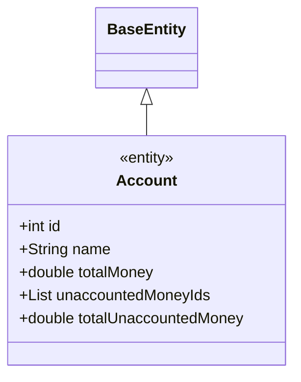

# Account Model and Use Cases

The `Account` model represents a financial account where money is held and expenses are tracked.

## Model Definition (`lib/domain/model/account.dart`)

## Use Cases

### Getters

*   **`GetAllAccountsUseCase`** (`lib/domain/usecase/account/getters/get_all_accounts_usecase.dart`)
    *   Retrieves all `Account` entities.
*   **`GetAccountByIdUseCase`** (`lib/domain/usecase/account/getters/get_account_by_id_usecase.dart`)
    *   Retrieves a single `Account` entity by its ID.
*   **`GetPageAccountsUseCase`** (`lib/domain/usecase/account/getters/get_page_accounts_usecase.dart`)
    *   Retrieves a paginated list of `Account` entities.

### Mutations

*   **`CreateAccountUseCase`** (`lib/domain/usecase/account/mutations/create_account_usecase.dart`)
    *   Creates a new `Account` entity.
*   **`UpdateAccountUseCase`** (`lib/domain/usecase/account/mutations/update_account_usecase.dart`)
    *   Updates an existing `Account` entity.
*   **`DeleteAccountUseCase`** (`lib/domain/usecase/account/mutations/delete_account_usecase.dart`)
    *   Deletes an `Account` entity by its ID.

---
See also: [Model Connections](model_connections.md), [Unaccounted Money Model and Use Cases](unaccounted_money_model.md)
