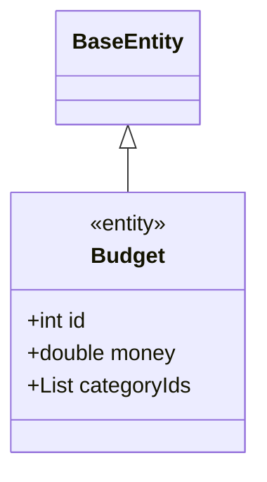
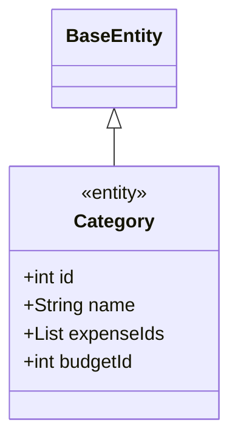

# Budget and Category Models and Use Cases

The `Budget` model helps in financial planning by allocating funds, while the `Category` model classifies expenses.

## Model Definitions

### Budget Model (`lib/domain/model/budget.dart`)

### Category Model (`lib/domain/model/category.dart`)

## Use Cases

### Budget Use Cases

*   *(Note: Use cases for Budget are not explicitly found in the provided directory structure for Getters/Mutations. Assuming standard CRUD operations would exist if implemented.)*

### Category Use Cases

*   *(Note: Use cases for Category are not explicitly found in the provided directory structure for Getters/Mutations. Assuming standard CRUD operations would exist if implemented.)*

---
See also: [Model Connections](model_connections.md), [Expense Model and Use Cases](expense_model.md)
