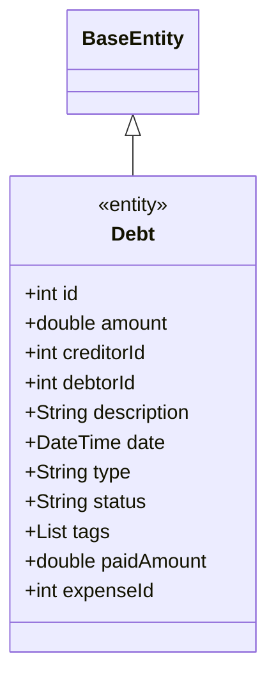

# Debt Model and Use Cases

The `Debt` model represents a financial obligation between two `Person` entities.

## Model Definition (`lib/domain/model/debt.dart`)

## Use Cases

### Getters

*   **`GetAllDebtUseCase`** (`lib/domain/usecase/debt/getters/get_all_debt_usecase.dart`)
    *   Retrieves all `Debt` entities.
*   **`GetDebtByIdUseCase`** (`lib/domain/usecase/debt/getters/get_debt_by_id_usecase.dart`)
    *   Retrieves a single `Debt` entity by its ID.
*   **`GetPageDebtUseCase`** (`lib/domain/usecase/debt/getters/get_page_debt_usecase.dart`)
    *   Retrieves a paginated list of `Debt` entities.
*   **`GetDebtsByCreditorIdUseCase`** (`lib/domain/usecase/debt/getters/get_debts_by_creditor_id_usecase.dart`)
    *   Retrieves debts where a specific person is the creditor.
*   **`GetDebtsByDebtorIdUseCase`** (`lib/domain/usecase/debt/getters/get_debts_by_debtor_id_usecase.dart`)
    *   Retrieves debts where a specific person is the debtor.

### Mutations

*   **`CreateDebtUseCase`** (`lib/domain/usecase/debt/mutations/create_debt_usecase.dart`)
    *   Creates a new `Debt` entity.
*   **`UpdateDebtUseCase`** (`lib/domain/usecase/debt/mutations/update_debt_usecase.dart`)
    *   Updates an existing `Debt` entity.
*   **`DeleteDebtUseCase`** (`lib/domain/usecase/debt/mutations/delete_debt_usecase.dart`)
    *   Deletes a `Debt` entity by its ID.

---
See also: [Model Connections](model_connections.md), [Person Model and Use Cases](person_model.md), [Expense Model and Use Cases](expense_model.md)
