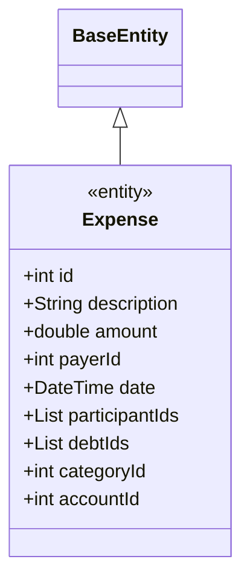

# Expense Model and Use Cases

The `Expense` model represents a single financial transaction, detailing who paid, who participated, and what it was for.

## Model Definition (`lib/domain/model/expense.dart`)

## Use Cases

### Getters

*   **`GetAllExpensesUseCase`** (`lib/domain/usecase/expense/getters/get_all_expenses_usecase.dart`)
    *   Retrieves all `Expense` entities.
*   **`GetExpenseByIdUseCase`** (`lib/domain/usecase/expense/getters/get_expense_by_id_usecase.dart`)
    *   Retrieves a single `Expense` entity by its ID.
*   **`GetPageExpensesUseCase`** (`lib/domain/usecase/expense/getters/get_page_expenses_usecase.dart`)
    *   Retrieves a paginated list of `Expense` entities.

### Mutations

*   **`CreateExpenseUseCase`** (`lib/domain/usecase/expense/mutations/create_expense_usecase.dart`)
    *   Creates a new `Expense` entity.
*   **`UpdateExpenseUseCase`** (`lib/domain/usecase/expense/mutations/update_expense_usecase.dart`)
    *   Updates an existing `Expense` entity.
*   **`DeleteExpenseUseCase`** (`lib/domain/usecase/expense/mutations/delete_expense_usecase.dart`)
    *   Deletes an `Expense` entity by its ID.
*   **`AddDebtToExpenseUseCase`** (`lib/domain/usecase/expense/mutations/add_debt_to_expense_usecase.dart`)
    *   Adds a debt associated with the expense.
*   **`RemoveDebtFromExpenseUseCase`** (`lib/domain/usecase/expense/mutations/remove_debt_from_expense_usecase.dart`)
    *   Removes a debt associated with the expense.
*   **`AddParticipationToExpenseUseCase`** (`lib/domain/usecase/expense/mutations/add_participation_to_expense_usecase.dart`)
    *   Adds a participant to the expense.
*   **`RemoveParticipationFromExpenseUseCase`** (`lib/domain/usecase/expense/mutations/remove_participation_from_expense_usecase.dart`)
    *   Removes a participant from the expense.

---
See also: [Model Connections](model_connections.md), [Person Model and Use Cases](person_model.md), [Account Model and Use Cases](account_model.md), [Debt Model and Use Cases](debt_model.md), [Budget and Category Models and Use Cases](budget_category_model.md)
