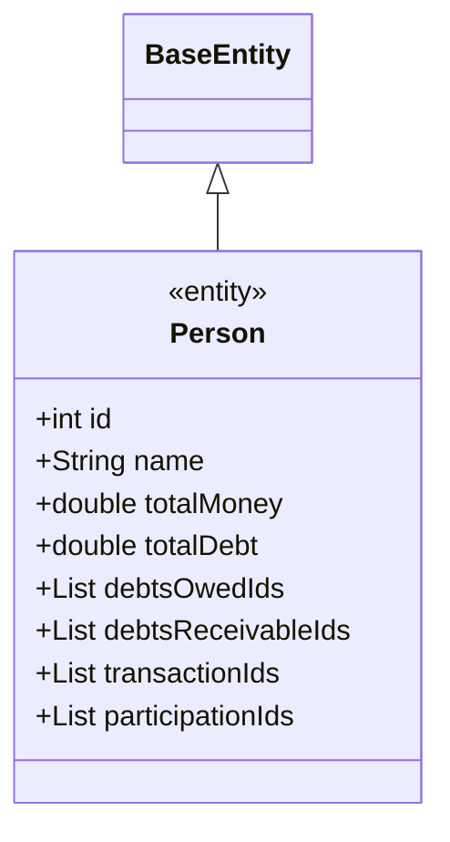

# Person Model and Use Cases

The `Person` model represents an individual associated with financial activities within the expense tracker.

## Model Definition (`lib/domain/model/person.dart`)

## Use Cases

### Getters

*   **`GetAllPeopleUseCase`** (`lib/domain/usecase/person/getters/get_all_people_usecase.dart`)
    *   Retrieves all `Person` entities.
*   **`GetPersonByIdUseCase`** (`lib/domain/usecase/person/getters/get_person_by_id_usecase.dart`)
    *   Retrieves a single `Person` entity by its ID.
*   **`GetPagePeopleUseCase`** (`lib/domain/usecase/person/getters/get_page_people_usecase.dart`)
    *   Retrieves a paginated list of `Person` entities.

### Mutations

*   **`CreatePersonUseCase`** (`lib/domain/usecase/person/mutations/create_person_usecase.dart`)
    *   Creates a new `Person` entity.
*   **`UpdatePersonUseCase`** (`lib/domain/usecase/person/mutations/update_person_usecase.dart`)
    *   Updates an existing `Person` entity.
*   **`DeletePersonUseCase`** (`lib/domain/usecase/person/mutations/delete_person_usecase.dart`)
    *   Deletes a `Person` entity by its ID.
*   **`AddDebtOwedToPersonUseCase`** (`lib/domain/usecase/person/mutations/add_debt_owed_to_person_usecase.dart`)
    *   Adds a debt owed by the person.
*   **`RemoveDebtOwedFromPersonUseCase`** (`lib/domain/usecase/person/mutations/remove_debt_owed_from_person_usecase.dart`)
    *   Removes a debt owed by the person.
*   **`AddDebtReceivableToPersonUseCase`** (`lib/domain/usecase/person/mutations/add_debt_receivable_to_person_usecase.dart`)
    *   Adds a debt receivable by the person.
*   **`RemoveDebtReceivableFromPersonUseCase`** (`lib/domain/usecase/person/mutations/remove_debt_receivable_from_person_usecase.dart`)
    *   Removes a debt receivable by the person.
*   **`AddParticipationToPersonUseCase`** (`lib/domain/usecase/person/mutations/expense/add_participation_to_person_usecase.dart`)
    *   Adds an expense participation to the person.
*   **`RemoveParticipationFromPersonUseCase`** (`lib/domain/usecase/person/mutations/expense/remove_participation_from_person_usecase.dart`)
    *   Removes an expense participation from the person.
*   **`AddTransactionToPersonUseCase`** (`lib/domain/usecase/person/mutations/expense/add_transaction_to_person_usecase.dart`)
    *   Adds a transaction to the person.
*   **`RemoveTransactionFromPersonUseCase`** (`lib/domain/usecase/person/mutations/expense/remove_transaction_from_person_usecase.dart`)
    *   Removes a transaction from the person.

---
See also: [Model Connections](model_connections.md), [Debt Model and Use Cases](debt_model.md), [Expense Model and Use Cases](expense_model.md)
