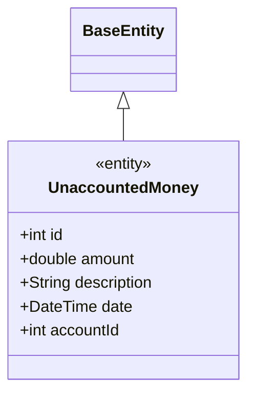

# Unaccounted Money Model and Use Cases

The `UnaccountedMoney` model represents funds within an account that haven't been assigned to a specific expense or category.

## Model Definition (`lib/domain/model/unaccountedmoney.dart`)

## Use Cases

### Mutations

*   **`CreateUnaccountedMoneyUseCase`** (`lib/domain/usecase/unaccounted_money/mutations/create_unaccountedmoney_usecase.dart`)
    *   Creates a new `UnaccountedMoney` entity.
*   **`UpdateUnaccountedMoneyUseCase`** (`lib/domain/usecase/unaccounted_money/mutations/update_unaccountedmoney_usecase.dart`)
    *   Updates an existing `UnaccountedMoney` entity.
*   **`DeleteUnaccountedMoneyUseCase`** (`lib/domain/usecase/unaccounted_money/mutations/delete_unaccountedmoney_usecase.dart`)
    *   Deletes an `UnaccountedMoney` entity by its ID.

---
See also: [Model Connections](model_connections.md), [Account Model and Use Cases](account_model.md)
